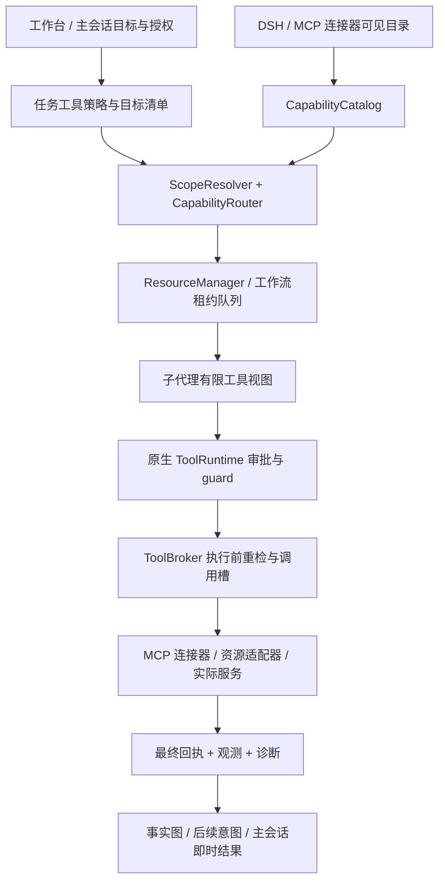

# MCP 工具层设计：按作用域选择、资源隔离与执行反馈

状态：设计稿，可据此分阶段实现；**alpha.19 尚未实现本文的租约、交互会话与资源隔离**。基线为 `e6dbcb8`，宿主仍为 **DSH NEXT 0.2.1-rc.2**。本文不修改当前安装包或复核默认值。

## 1. 依据与设计决定

已阅读用户提供的本地文章《为什么你的 AI 智能体解不出 CTF 题：Pwn 篇》（2026-11-15），并核对 [TeamH4C 原文](https://h4c.team/en/posts/97)；[微信译文](https://mp.weixin.qq.com/s/cGzXCe4U3KPWrTMzFm_Rew)在线访问返回验证码。文章指出工具输入、交互式观测、前提条件、失败恢复和成功标准都会影响解题。本文据此提出以下工程设计，**资源租约和协议字段是 Sapper 的设计，并非文章已有的规范**，也不据文章实验数字承诺本插件成功率。

| 文章暴露的问题 | 工具层的对应设计 |
| --- | --- |
| 缺少库、架构或运行时信息 | 文件与环境清单；按能力发现工具；缺少能力返回明确原因 |
| shell 难以保持 GDB/远程交互状态 | 持久交互句柄、输出游标、明确的 running/stopped/eof/crashed 状态 |
| 已找到漏洞却缺少地址或原语 | 带有效范围的测量记录；由所选解法声明前提，不强制所有题走同一流水线 |
| 在已损坏的进程状态上重复尝试 | epoch 失效、诊断与恢复计划；保留静态结果，重新测量动态值 |
| 把崩溃、代码生成或外部答案当成成功 | 区分行为观察、flag 候选、独立复核、平台接受；记录来源 |

核心决定：在现有 DSH ToolRuntime 与 MCP 连接器之间增加宿主级 `ToolBroker`，**先确定实际权限和资源，再给代理展示工具；每次执行重新检查，并通过同一个资源调度器进入原工具管线**。IDA、GDB、浏览器、数据库采用不同资源适配器，不把 `mcp__*` 当作隔离机制。

比赛流程保持 alpha.19 的速度选择：默认轻量检查；可关闭或选择性启用独立复核；每个新候选立即回显。租约等待、环境检查、证据绑定不要求用户逐次审批。宿主或连接器原有 ask/deny 仍生效，完全权限不会消除资源冲突。

## 2. 现状及可用接入点

| 当前代码 | 已有能力 | 缺口 |
| --- | --- | --- |
| `src/orchestration/tool-policy.ts` | 精确名称和 MCP 命名空间前缀；角色上限 | 无能力标签、资源映射 |
| `src/orchestration/engine.ts` | 父会话权限交集、有限 mask、执行 guard、工具变更刷新 | 无跨子代理共享锁；成功回执无数据库/进程身份 |
| `src/panel/capabilities.ts` | 指定主会话可见工具、模型和警告 | 注册、可见、健康、可绑定尚未分别表达 |
| `src/store/runs.ts` | 调用、候选、复核和子会话记录 | 无资源版本、来源或诊断恢复协议 |

已核对本地 `@deepseek-ai/dsh-tools@0.2.1-rc.2` 的声明和执行实现：`tools/pre-execute` 可异步门控，`tools.guard()` 为单调同步拒绝；`tools/execute` 可包围真实执行，且只允许替换 signal；`tools/result` 是最终只读结果通知。`restrict()` 不能替代执行 guard，SDK 的单代理调用并发分类也不等于不同代理之间的资源锁。

V1 沿用**原生 MCP 公开工具名及参数 schema**。Broker 不改写调用身份、参数或返回 schema，不直接调用 `ToolDefinition.execute()`，不伪造父 Agent。先通过原审批和 guard，再在 `tools/execute` 内获取调用槽、再次验证并 `await next()`，在执行体真正排空后释放。这样保留连接器授权、会话日志和原生证据回执。需要参数转换或新增能力的适配器注册独立的新工具，不在 around hook 偷改参数；其委派也必须走 ToolRuntime，并保留发起者权限。

## 3. 分层与职责



- `CapabilityCatalog`：可见工具与 schema 的快照；记录连接来源、修订和健康状态；不持有凭据副本。
- `ScopeResolver`：从真实 Agent、Workspace、任务及宿主权限推导授权范围。模型参数不能指定自己的身份或更高权限。
- `CapabilityRouter`：将解题所需能力映射为工具候选，返回选择理由与缺失原因；排序不创造权限。
- `ResourceManager`：物理资源身份、工作流租约、实例池、调用槽、排队和隔离状态。
- `ToolBroker`：接管受保护工具执行；串联原权限管线、资源校验、取消、最终结果归档。
- `ResourceAdapter`：理解 IDA 数据库、GDB inferior、浏览器 context、数据库连接等真实状态；显式声明保证边界。
- `ObservationStore`：关联测量、输出、前提和失效范围；与已有事实图集成，不把工具层结果自动标为 confirmed。

连接创建、OAuth、API Key、凭据轮换继续由 DSH/连接器负责。Sapper 管理使用策略和资源生命周期；只有已登记的实例提供者可以代为创建隔离工作进程。

## 4. 作用域协议与工具选择

### 4.1 四种范围分别计算

| 范围 | 示例 | 决定什么 |
| --- | --- | --- |
| 授权范围 | profile / Workspace / 主会话 / 子 Agent | 能否发现与执行 |
| 任务范围 | challenge / task / run / intent / role | 本次工作需要什么 |
| 资源范围 | backend / 数据库 / process / browser context / connection | 状态共享和互斥键 |
| 证据范围 | 文件摘要 / 环境指纹 / epoch / 输出游标 | 哪些结论仍可使用 |

`workspaceId + taskId + runId` 必须同时使用；challenge 用根题目稳定 ID 聚合，不能把每个阶段的 `r001` 当成全局执行 ID。`hostInstanceId` 为每次启动随机 UUID；子会话身份由编排器预留的 ID 绑定，不能由工具请求覆盖。

有效工具集合：

```text
宿主当前注册并可执行的工具
∩ 连接器当前 Workspace / Agent 可见范围
∩ 父会话与祖先范围允许的工具
∩ Sapper 角色配置上限
∩ 本任务能力需求与显式工具选择
∩ 已绑定资源支持的操作
```

每个交集项分别记录 revision；推理边界刷新展示，**执行前再重算权限、schema 摘要、资源绑定和租约**。缓存命中不代表仍有权限。撤销立即阻止尚未执行的调用；已执行调用进入取消与排空，不能通过更换公开别名恢复权限。

### 4.2 能力描述与选择策略

能力使用稳定的点分 ID，例如 `binary.inspect`、`binary.decompile`、`binary.library.inspect`、`debug.start`、`debug.memory.read`、`debug.control`、`io.interact`、`web.browser`、`db.query`。ID 表示需求，工具公开名仍由宿主目录提供。适配器元数据来自本地维护配置/已校验提供者；远端工具描述和 `readOnlyHint` 仅辅助展示，不据此授予权限或共享锁。

默认 `selection=auto`：先使用附件清单、文件特征和当前意图选能力；再按“有目标绑定、隔离已就绪、无需等待、有可靠健康信息”排序。新建题目可覆盖自动选择或固定配置组。用户显式选中的工具仍受作用域交集限制，不能绕过资源约束。

- ELF/PE：静态识别与反编译组；有动态信息需求再取得调试组；随题 libc/loader 作为独立资产纳入清单。
- Web：HTTP 和浏览器能力；每题单独 cookie/storage context。
- Pwn 动态测量：绑定目标文件、libc/loader 和启动环境，再申请 GDB 与交互连接；不把静态基址冒充运行地址。
- 数据库：使用此题的 connection/schema/transaction 句柄；按服务支持能力选择只读连接或独立副本。
- 类型未知或混合：保留基础文件工具与目录搜索，允许代理显式请求新能力；不因首轮分类永久限制路线。

`reason` 默认只查图和能力目录，不执行 MCP 业务工具；`explore` 可申请任务所需能力；`verify` 仍按用户选择触发，使用独立会话和独立或重置资源。写 WP 优先只读证据与文件，不自动占用调试器。需要补测时先生成新的明确意图。

模型可调用 `sapper_tools.search/describe` 搜索**已获授权的目录**，再申请本任务允许的能力。轻量目录不一次塞入全部 schema；子代理初始只暴露所选组，新增组在下一个推理边界生效。没有某项能力时返回 `missing`，允许选择文件/shell 替代或调整路线，不循环空找 IDA。

### 4.3 与 MCP 连接器的衔接

已核对 [dsh-mcp-connector 固定提交](https://github.com/duhu2000/dsh-mcp-connector/tree/377bfe9d9ceec9303726987b7fc4dc3e44a15eb1)：连接可按 global/project 限制；按会话启用工具还受 Agent 激活约束。`mcp_connector_session_tools` 的激活需要精确工具选择和其自身确认契约。

V1 不自动把 `confirmed=true` 当作通用开关，不将主会话激活复制成子会话授权。连接器若没有正式的受限委派 API，标记 `activation-required`，提供一次配置入口或使用用户原先选择的始终注入模式。未来委派接口必须携带精确工具、目标 Workspace、子 Agent、期限和父授权引用；连接器拒绝时不回退到越权调用。`mcp__*` 仅为角色上限，不等于跨工作区授权或连接器激活。

## 5. 资源身份、隔离策略与保证等级

### 5.1 资源键

```text
backendKey = H(管理员配置的物理 backendId + 授权域)
resourceKey = H(backendKey + resourceKind + 服务确认的资源身份)
owner = hostInstanceId / workspaceId / taskId / runId / agentId
```

服务别名和 `mcp__server__*` 不能作为唯一锁键。两个连接指向同一个 IDA 后端，必须共享 backendKey；负载均衡端点必须提供稳定资源路由或显式 handle。不同 HTTP 连接、MCP transport session、模型会话都不自动意味着不同数据库。资产摘要用于判断内容相同，**不能据相同文件摘要把两个独立可变数据库合并成同一实例**。

### 5.2 默认隔离选择

| 服务状态模型 | 默认策略 | 并发条件 |
| --- | --- | --- |
| 经确认的无状态查询 | stateless + 速率/并发额度 | 服务与操作已声明无共享可变状态 |
| 所有调用均接受并校验资源 handle | explicit-handle，每题/会话独立 handle | 后端验证隔离，状态访问不落回全局 current |
| 可创建独立 worker/context/database | dedicated-instance，每题资源副本 | 独立数据目录、状态、端口/handle；满足池容量 |
| IDA current DB、单 GDB inferior 等隐式状态 | exclusive-workflow | 一个工作流持有整个后端，从绑定到导出不交错 |
| 未知 MCP | generic-exclusive，工作流串行 | 显示“已串行，目标身份未认证”；不声称强隔离 |

优先级不是强行给所有服务拉起进程：先复用已支持的隔离 handle，其次使用已配置实例提供者，最后安全串行。缺少 worker 启动能力时排队，不能凭空生成一个“独立 IDA”。

区分三种保证：`process`（专属 worker，仍受其 OS 权限限制）、`verified-handle`（服务提供并校验资源身份）、`serialized`（仅在接管范围内不交错，可能无目标认证）。进程隔离不等于文件/网络沙箱；对不可信服务的访问边界由宿主与 worker 沙箱落实。MCP Roots、工具 annotations 都不能替代访问控制。

### 5.3 IDA 的具体契约

1. 收集待分析 binary 与库的 SHA256、原始附件引用和工作目录，创建该题的分析数据库副本，保留原附件只读。
2. 若存在受信任的 IDA worker 提供者，取得专属实例。适配器读取服务实际支持的数据库信息，核对输入摘要/数据库标识/worker generation；不能假设某个 IDA MCP 实现必有特定 API。
3. 只有单个 current DB 服务时，申请 **backend 级工作流独占租约**，在租约内打开样本、查询、反编译、必要修改和导出。A 分析期间 B 不能切到另一数据库，即使两个调用都叫“读取”。
4. 同一租约下默认 `maxInFlight=1`；仅在适配器证明当前库固定、操作线程安全时允许同一工作流内只读并发。不同题、不同 verifier 不共享可变数据库。
5. 显式换库、patch、重新分析或外部状态变化更新 epoch，失效相关测量。目标核对失败返回 `TARGET_MISMATCH`，不把旧库输出当新题证据。
6. 无法读取数据库身份时保留 `unattested` 标识，先使用串行退化模式；可收集观察，但不能据此声称已经证明目标绑定或独立复现。

## 6. 租约与并发协议

### 6.1 两层调度

- **工作流租约**保护跨调用状态，owner 绑定具体子 Agent/工作流。不能只用 taskId 作为重入键，否则同题并发探索者仍会互相污染。
- **调用槽**限制同一实例的 in-flight 调用数量。exclusive-workflow 仍可能需要单调用槽；无状态服务则只需额度，不人为把整题串行。

多资源请求必须声明完整 bundle，按 backend/resource 稳定顺序原子分配；不持有 A 等待 B，也不允许工作中无限升级资源集合。新增需求在安全点释放/重排，或者拆成下一意图。按物理资源 FIFO 排队，读写队列避免写者饥饿；不同 backend 可以并行。实例上限服从提供者与 DSH 子代理容量。

协调器优先在启动昂贵模型轮次前申请资源；等待期间不启动子代理、不消耗模型 token/步数。实际执行时仍需调用槽，等待以宿主状态显示，不让模型轮询。调度必须避免“占模型槽等资源、占资源等模型槽”的循环：容量与资源由同一个协调请求统一发放，或取得资源后无法启动时归还资源重排。等待时间单独计量，默认等待上限 5 分钟，可配置；仍服从任务总墙钟期限，不偷偷延长无限运行。

单次等待到期返回 RESOURCE_BUSY 并保留待办，不直接宣判整题失败；调度器可以先推进无需该资源的路线或在宿主队列等待下一次资源通知。不得让模型反复调用 acquire 维持排队。需要长期占用的 current DB 工作流可以在导出安全快照后让出资源，不能在未保存的中间状态被抢占。

### 6.2 状态机

```text
requested → queued → provisioning → active → draining → released
                  ↘ failed             ↘ quarantined → reset → released
```

租约包含 `leaseId`、owner、resourceKey、generation、单调 fence、heartbeat、过期时间及保证等级。公开 leaseId 只是引用，不是 bearer token；真正所有权使用宿主内存绑定和不可伪造调用身份，不能在聊天中转交。新的 hostInstanceId 不接受旧租约。

心跳由宿主维持，不要求模型续租。**过期不等于资源空闲**：先停止接收新调用，再取消、等待执行体排空并核对状态。取消不合作、断网或远端执行不明时进入 quarantined。只有确认进程结束、服务确认操作停止，或已恢复到可核验状态后才重新分配。

fence 只有服务/worker 实际拒绝旧 fence 才能阻止过期持有者继续写；仅把数字记在本地日志不能提供远端 fencing。未支持 fencing 的服务必须等待 quiescence 或销毁专属 worker，不得靠 TTL 强行抢占。未知副作用不自动重试；只对明确幂等、未改变目标 epoch 的操作允许有界重试。

### 6.3 接管边界

V1 为 **同一 DSH 宿主进程的根服务**，所有 Sapper 工作区和子 Agent 共用，不跟随页面挂载/卸载创建。对登记为受保护的原生 MCP 工具，主会话及其他 Agent 的直调也进入同一调度器；无工作流租约的临时调用需等当前工作流释放，改变状态则更新 epoch。

外部脚本、另一个 DSH 进程、其他 profile 的独立进程和绕过 MCP 直连网关不在该内存锁的保证范围。需要覆盖它们时，必须部署统一网关/机器级协调器，使每条入口都校验租约；否则界面明确显示“仅当前宿主协调”。不能用“另一个锁文件”或不同前缀宣称已解决跨进程冲突。

目前全权限 bash/pwsh 可直连网关。V1 不扫描 shell 文本猜测网络行为；默认执行指引要求走 Broker，并将保证限定为接管调用。需要强保证的题目可选择受宿主支持的隔离 worker/网络出口规则，使工具网关只接受 broker 身份。没有可验证的强制执行能力时，不显示“已强隔离”。

## 7. 协议对象与 API

Sapper 扩展协议标识为 `sapper-mcp/1`，与上游 MCP wire protocol 独立，不要求服务实现新的 MCP 标准。机器协议定义在 [JSON Schema](protocols/sapper-mcp-v1.schema.json)，可验证消息见 [示例](protocols/sapper-mcp-v1.examples.json)。它定义 profile、selection、lease、invocation、receipt、observation、repair-plan、interactive-request、interactive-result 九种对象；执行 API 仍须做宿主身份、授权和资源状态验证，schema 通过不等于授权通过。

### 7.1 调用面

| 调用 | 主要参数 | 约束 |
| --- | --- | --- |
| `sapper_tools.search` | query / capabilities / cursor | 只返回调用者可见目录；不执行 MCP |
| `sapper_tools.describe` | toolRef + catalogRevision | 返回精确 schema、绑定需求、选中/排除理由 |
| `sapper_resource.acquire` | requestId / profileId / assetRefs / purpose | 实际 owner/Workspace/run 来自宿主；通常由协调器自动调用 |
| `sapper_resource.status/release` | leaseRef | 限同 owner；重复释放幂等；release 等待排空 |
| 原生 `mcp__…` 业务工具 | 原参数 schema | guard + Broker + 实际资源，未经授权的调用不执行 |
| `sapper_interact` | action / sessionRef / cursor / bytes / waitMs | 仅在有对应适配器时提供；同 owner，有限等待 |
| workbench 查询 RPC | workspaceId + taskId + runId | owner-only、只读；查看历史不 acquire、不重放 |

上述点分名称表示接口操作；实现时 `sapper_tools`、`sapper_resource` 可各注册一个带 action 的 DSH 工具，避免依赖工具名是否接受点号。Broker 管理工具与已有 sapper 读图工具分别分类，不通过 `externalTool()` 放行任意控制面。规划角色仅开放 search/describe/status；release 不允许释放其他子会话资源。

`profile` 为 owner 维护的适配配置，包括 connectionRef、稳定 backendId、能力映射、精确公开工具和隔离策略。它不是可从附件/网页导入并自动生效的授权文件。selector 通配符只在受限目录中展开；manifest 的能力映射指向精确工具名及 schema 摘要。

`selection` 保存本次目录 revision、owner 上下文、能力需求、有效工具、排除理由和策略 revision。无匹配、被工作区排除、Agent 未激活、角色禁止、等待实例、目标不匹配分别表达，不能全部显示成“工具不存在”。

`invocation` 使用 `exec.token` 在宿主关联上下文，归档时另分配 UUID `invocationId`。模型仅提供原生业务参数；协议中的 caller、fence、targetBinding、权限 revision 均由宿主填写。argumentsDigest 用冻结后的实际参数计算，不能由模型预先承诺。

schema 中 owner 是任务内归档上下文；主会话临时直调使用宿主内部 session owner（不伪造 taskId/runId），仍共享 backend 队列。queued 租约可以没有尚未分配的 resource/fence，进入 active 后必须完整。目标身份可为文件摘要、服务确认的数据库或目标端点，浏览器/数据库不要求伪造文件 SHA256。

### 7.2 与 MCP wire 的边界

连接器继续负责上游版本协商、tools/list、tools/call、授权和取消。Broker 不把 `Mcp-Session-Id` 当成题目隔离标识：旧协议 transport session 不保证应用状态隔离，新版协议也不能假设此 header 存在。以 [2025-11-25](https://modelcontextprotocol.io/specification/2025-11-25/basic/transports) 和 [2026-07-28](https://modelcontextprotocol.io/specification/2026-07-28/basic/transports) 两类服务分别做适配测试，**不因此放宽 DSH 版本支持范围**。

扩展元数据仅在适配器/服务协商支持时附加到 MCP `_meta` 自有命名空间；不擅自新增业务 arguments 字段。即使携带 fence，服务未执行检查仍视作不支持 fencing。上游取消由连接器按协商版本处理；Broker 始终按真实终止/排空结果决定是否可重用资源。

## 8. 交互式调试与远程 I/O

`sapper_interact` 仅聚合已实现的 GDB/远程连接适配器；缺少底层会话能力时返回 missing，不靠轮询独立 shell 假装有持久会话。

- `start`：绑定目标资产、库、环境指纹、资源租约，返回宿主生成的 sessionRef。
- `write`：发送显式编码的文本或 base64 bytes，带幂等 requestId；超时后不能盲目重发输入。连接不支持 exactly-once 时标明 delivery-unknown。
- `read`：用单调 cursor 获取新输出，返回 nextCursor、是否还有未读内容和进程状态。cursor 是共享不可变 transcript 的字节位置（UTF-8 按码点边界切片，原始二进制用 base64），不是竞争消费 socket 的游标。空输出、等待输入、已停止、eof、崩溃、工具失败分别表达。游标超出已保留范围返回 CURSOR_EXPIRED 及产物入口，不静默跳过。
- `interrupt/stop`：是会改变状态的操作，仍遵守租约、取消和排空。GDB continue/step 同样是状态修改，不能因“调试”而标只读并行。
- `snapshot`：记录寄存器、内存片段、映射、stop reason 与 source receipt；只在适配器真实支持时提供。

每个进程/连接最多一个输入写者；其他代理读取不可变 transcript/snapshot，不能竞争消费同一 socket 或共用 GDB 当前 inferior。允许同一题的静态分析代理与动态调试代理使用不同资源并行。日志过长分页并保存完整原始产物；单页可设字符限制，不能静默丢掉二进制、末尾 flag 或关键崩溃信息。终端数据显示为不可信内容，控制字符不直接驱动 UI。

远程题目进程并不一定由本地服务控制。断开重连、服务器重启或地址泄露属于不同连接/进程时必须更新证据范围；无法证明进程连续性时，不复用绝对地址和 canary。

## 9. 观测、证据和失败恢复

### 9.1 最终回执

原有 evidence receipt 继续使用成功最终工具结果生成；新增 broker 回执关联 `invocationId`、原始 callId、owner、toolRef/schemaDigest、backend/resource/epoch、目标绑定状态、参数/结果摘要、时间与产物引用。排队、预览、失败、取消、迟到结果都不能被包装成成功证据。原始输出、adapter 解析值与模型解释分开存储，哈希只证明记录一致性，不证明语义正确。

大型输出先保存完整本地产物再通知可分页引用；发现通知处理原始可用输出，不等待 WP、独立复核或其他工作流结束。候选卡展示 `来自目标 / 附件 / 外部参考 / 未绑定来源`；只有明确来自目标范围的候选计入目标收集策略，外部参考保留可见但不冒充本题 flag。身份未认证的通用 MCP 输出仍可展示观察，不显示“目标已认证”。这项来源收紧需要单独回归 alpha.19 的计数行为。

来源是适配器对实际输出通道的记录，不能由模型填写 `source=target` 获得认证；shell 回显参数、复制的 WP 和目标 stdout 必须分开。属于本题目标的附件文件可以构成有效目标证据，并不要求所有题都在线获取 flag。未知来源照样立即显示候选，由用户提交判断，不因等待来源核验而隐藏字符串。

### 9.2 测量与有效期

`observation` 包含 claim、actual value、unit、receiptRefs、basis、validity 与依赖。例：

| 观察 | 有效范围 | 失效条件 |
| --- | --- | --- |
| ELF 架构、函数偏移、libc gadget offset | 文件摘要；必要时分析数据库 revision | 文件/数据库改变 |
| 栈溢出 offset | binary + 启动环境/实测路径 | 构建、参数、环境或路径改变，需要重测 |
| PIE/libc 绝对基址、canary | 特定 inferior/远程连接 epoch | exec、重启、重连或无法证明状态连续 |
| heap 布局、当前寄存器 | 特定进程 state revision/stop event | 继续执行、状态修改或崩溃 |
| 浏览器登录状态 | browser context + credential generation | 清理、会话过期或凭据变化 |

`basis=tool-parsed` 表示适配器从真实输出解析；`agent-inferred` 表示代理推断，不能自动充当已测量前提。所选策略可以声明 required observations；调度只阻止**该路线中已经声明但缺失/过期的前提**，并返回缺口，不强加所有题都需要 ASLR 泄露、ROP 或全量二次验证。

这些门控复用现有回执，是轻量一致性检查；none/lightweight 不因此暗中启动 verifier。observed、confirmed 和平台 accepted 的含义保持分开；平台 accepted 只由真实提交回执或用户明确录入，插件不自动替用户提交 flag。

### 9.3 诊断与恢复

失败生成 `repair-plan`：failure receipt、已保留观察、需失效观察、原因、恢复点、下一项缺少的测量或改动。模型负责提出诊断，适配器确认资源状态，宿主验证计划引用和作用域；不能让失败输出中的文字直接变成可执行 shell 指令。

优先保留文件级事实与生成的脚本；对损坏 heap/inferior 重启隔离资源，更新 epoch，重测地址，再从可信准备步骤继续。相同输入、相同环境和同一失败指纹重复时，提示选择新的观测或路线；不无限自动重试，也不因一次异常丢掉全部进展。

重放只限用户已授权范围内的显式 replay-safe 步骤；写库、远程副作用、未知操作和不确定是否已送达的 socket 输入禁止自动重放。没有可靠恢复点时创建新资源，而不是假称已经恢复。历史运行和 WP 保存当时证据快照，不随新 epoch 或后续复核改写。

## 10. 配置与界面

设置页新增“工具与资源”四区：

1. **能力目录**：按选定主会话显示已注册/当前可见/需激活/缺少适配/最后成功调用；保留现有搜索和角色范围设置。
2. **资源配置组**：连接引用、物理 backendId、资源策略、实例容量、保证等级；高级字段折叠，提供 IDA/GDB/浏览器模板。选同一物理后端的别名时提示合并协调域。
3. **任务默认选择**：auto/固定组、按题型推荐；资源策略和复核策略分开保存。旧 exploreTools/verifyTools 保留为角色上限。
4. **运行诊断**：当前 owner、等待队列、等待原因、资源占用、quarantined 状态、失败恢复入口。重置/销毁仅针对插件拥有的 worker；不能关闭用户原有 IDA 或删除原数据库。

新题默认自动选择，表单可展开查看“本题将使用的能力、目标、隔离等级和缺口”。运行详情增加工具/资源页签；主会话只提示开始、等待、缺口、发现和结束，不刷屏每次心跳。等待期间输入框可编辑，steer/cancel/continue/WP 保持现有快捷路径；取消清理资源不阻塞已经发现的候选回显。

配置分为三个持久域：用户工具策略、可恢复队列/资源元数据、每题证据快照。资源策略变更仅影响后续租约；权限撤销立即生效；活跃租约不能被 UI 降低隔离。新策略不通过现有整体 Config fingerprint 误杀所有任务，需要专门的 revision 与权限撤销路径。

## 11. 存储、恢复与错误

全局 storageDomain `sapper_tool_broker` 保存配置 revision、物理资源映射、等待请求和租约元数据；**不保存可重新授权的活跃 token、OAuth secret 或远端操作重放命令**。题目 `.sapper/tasks/<task>/` 保存 protocol 回执/observations；大文件在 artifacts 中，路径经现有工作区边界检查。Windows 中文路径、大小写、UNC、符号链接/junction 均走规范路径解析，不使用简单字符串 startsWith 判断归属。

重启时排队请求可恢复，但先复查 owner、任务状态和权限；原 active/draining 资源全部先置为 interrupted/quarantined，禁止按磁盘 lease 自动复用。专属 worker 通过提供者核验进程创建标识而非只看 PID，确定性结束或重新绑定后才分配。历史查询无任何执行副作用。

| 错误码 | 行为 |
| --- | --- |
| `SCOPE_DENIED` / `ACTIVATION_REQUIRED` | 明确是范围或连接器激活问题；不自动提升权限 |
| `CAPABILITY_MISSING` / `ADAPTER_UNAVAILABLE` | 返回可用替代；不靠增加 token 修复 |
| `RESOURCE_BUSY` | 宿主排队，显示 owner 与可取消状态 |
| `TARGET_MISMATCH` / `STALE_EPOCH` | 拒绝消费旧状态，重新绑定或测量 |
| `LEASE_REVOKED` / `SCHEMA_CHANGED` | 未开始调用不执行；刷新后显式重试 |
| `DELIVERY_UNKNOWN` / `RESOURCE_QUARANTINED` | 不自动重放副作用，不将超时当作已释放 |

## 12. 实施顺序与验收

建议新增 `src/mcp/`：`catalog.ts`、`scope.ts`、`router.ts`、`broker.ts`、`resources.ts`、`leases.ts`、`protocol.ts` 和 `adapters/`。这些路径是待实现模块，当前并不存在。现有 `engine.ts` 改为消费 router 的有限工具视图、在激活前申请资源并保存 broker 回执；`panel/capabilities.ts` 增加排除原因；`workbench` 对接资源等待与取消；`store/runs.ts` 只增加可选协议引用，保留旧运行可读。不要先在每个子代理内各写一个 Map 锁，随后再尝试合并。

| 阶段 | 交付 | 退出条件 |
| --- | --- | --- |
| T1 | Catalog/ScopeResolver、配置预览、profile/协议校验 | 现有父权限与连接器约束全部保留，选工具有理由 |
| T2 | 根 Broker、工作流租约、调用槽、通用串行与 IDA 适配 | 两题共用 IDA 不切错库；取消排空；主会话直调受协调 |
| T3 | 隔离实例池、GDB/远程交互、版本化观测与诊断恢复 | 重启失效动态测量；独立 worker 并行；无忙等模型 |
| T4 | 工作台资源视图、迁移、真实宿主与 Windows 验收 | UI/队列/主会话闭环和既有 alpha.19 回归通过 |

建议分阶段交付，不把支持所有 MCP 服务作为 T2 的前提。T2 可以先在无法启动多 IDA 时稳定串行；T3 有真实 provider 后再扩大并行。v1 schema 作为实施契约，新增可选字段需协商 schema revision（严格对象的旧消费者不会自动接受），破坏语义变更升级协议版本。

必测场景：

- 工作区 A 看不到 B 的连接；父会话撤销后缓存 selector 不能恢复；会话激活不能伪造继承；模型伪造 owner/lease/fence 被拒绝。
- 两个别名指向同一 IDA 时共享锁；A 打开 binary-A 后，B 的切库操作必须等待 A 导出/释放；相同题内两个 explore 也不共享可变 current。
- IDA 专属 worker 并行，两库/数据目录互不污染；缺少实例提供者自动排队，不能伪造可用实例。
- readOnlyHint 声称只读但改变 current 的工具仍按适配器保护；跨进程绕过仅显示有限保证，不能在结果中写“已全面隔离”。
- 取消等待、执行中取消、服务忽略取消、断网、迟到结果、租约过期、宿主崩溃和 PID 重用均不会提前重分配或自动重复副作用。
- bundle A+B 不发生互相持锁等待；降低并发只影响后续调度；没有 DSH 容量时不长期占住资源；等待不耗模型预算但受总期限限制。
- GDB read 空输出与 eof/崩溃不同；二进制输入 round-trip、游标分页、重复 write requestId、delivery-unknown、连接隔离均正确。
- 重启 inferior 后地址/canary/heap 观察失效，文件级反编译事实仍可引用；修复计划不复用不安全前缀，不把推断值变成实测值。
- 新 flag 在资源清理和可选 verifier 前回显；多 flag、none/lightweight/selective/independent、定向复核、WP/纠错及历史快照全部保持。
- 使用真实 DSH 0.2.1-rc.2 ToolRuntime/AgentLoop/会话/Gateway/插槽测试，验证 around hook 不改身份/参数，不绕原权限，不更换工具 schema；再补真实 IDA/GDB provider 的隔离测试，不能只用 fake mutex 测试宣称服务隔离成功。

本次设计交付的 JSON Schema draft 2020-12 校验通过，**24/24 个结构样例**（13 正例、11 反例）与文档本地链接检查通过；**尚未执行上述运行时验收，也未发布新的插件版本**。schema 只检验对象结构；跨消息引用、owner/lease 实时归属、receipt 成功状态、target 一致性、epoch/fence 新鲜度、preserve 与 invalidate 不相交、游标单调和时间顺序均需宿主的语义验证器，不能用 JSON Schema 代替。

## 13. 参考与边界

- 用户本地文章：[为什么你的 AI 智能体解不出 CTF 题：Pwn 篇.html](</home/luchitong/为什么你的 AI 智能体解不出 CTF 题：Pwn 篇.html>)；[TeamH4C 原文](https://h4c.team/en/posts/97)。本文只提取设计问题，不复用实验成功率作产品承诺。
- [MCP Tools 规范](https://modelcontextprotocol.io/specification/2026-07-28/server/tools)：发现、调用及 schema 的协议边界。
- [官方 annotations 说明](https://blog.modelcontextprotocol.io/posts/2026-03-16-tool-annotations/)：提示元数据不等于强制执行。
- [MCP 2025-11-25 取消](https://modelcontextprotocol.io/specification/2025-11-25/basic/utilities/cancellation)：发出取消不保证服务已停止。
- [dsh-mcp-connector 作用域源码](https://github.com/duhu2000/dsh-mcp-connector/blob/377bfe9d9ceec9303726987b7fc4dc3e44a15eb1/lib/connection-scopes.js)与[会话工具接口](https://github.com/duhu2000/dsh-mcp-connector/blob/377bfe9d9ceec9303726987b7fc4dc3e44a15eb1/lib/tools.js)：连接器治理独立保留。

后续落地时应重新核对连接器所安装版本；此处固定提交用于让设计依据可追溯，不把当前 main 的接口当作 alpha.19 已具备的依赖。
