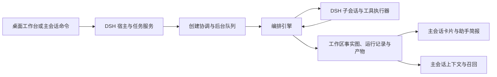

# Sapper-DSH 项目报告

- **记录日期** 2026-11-26
- **分支** `work/pwn-orchestration`
- **评估基线** `0.1.0-alpha.24`，基于提交 `fdb8765`
- **目标环境** Windows DSH NEXT `2.0.24-next`，内置 DSH SDK `0.2.2-rc.5`

## 1. 项目现状

Sapper-DSH 把 Sapper 的工作区事实图、上下文召回和子代理编排接入 DSH NEXT。用户通过工作台或主会话提交明确目标，宿主创建或选定工作区，在后台推进任务，把观察、证据、独立复核和运行结果保存到该工作区。桌面端提供跨工作区任务列表、运行干预、事实图和文件查看。 [项目说明](../README.md) · [桌面工作台](task-panel.md)

当前打包与验收版本是 `alpha.24`。本分支从 `main` 的 `fdb8765` 切出，该提交清单的版本是 `alpha.21`。分支包含此前已在本地打包和验收的 `alpha.24` 代码与依赖更新，本报告以该版本及其产物为准。 [当前包清单](../package.json)

## 2. 架构与执行链路

| 模块 | 职责 | 实现入口 |
| --- | --- | --- |
| 宿主适配 | 通过 Cordis 注册工具、命令和设置，处理权限、配置变更、上下文注入和远程接口 | [宿主入口](../src/index.ts)、[运行时](../src/dsh-adapter/host.ts) |
| 桌面客户端 | 使用 DSH 正式插槽注册左侧工作台、输入框入口、设置和主会话结果组件 | [客户端入口](../src/client/index.tsx)、[工作台](../src/client/workbench.tsx) |
| 任务协调 | 创建目录、原生工作区与会话，恢复创建请求，管理后台队列和结果回传 | [任务面板服务](../src/dsh-adapter/panel.ts)、[原生工作台](../src/workbench/native.ts) |
| 编排 | 使用 DSH 原生 spawn，控制角色、模型、工具、预算、证据和取消 | [编排引擎](../src/orchestration/engine.ts)、[子代理预算](../src/orchestration/budget.ts) |
| 工作区数据 | 处理事实、意图、文档、提示和运行的校验、锁和事务恢复 | [事实图](../src/store/graph.ts)、[文件读写](../src/store/io.ts) |
| 上下文和召回 | 基于目标与 frontier 注入有限上下文，对中英文事实和意图进行召回，提供离线知识库 | [上下文](../src/render/context.ts)、[召回](../src/recall/index.ts)、[知识库](../src/kb/index.ts) |
| 工具资源 | 兼容模式协调 MCP 资源和回执，按需模式提供只读本机 IDA 元数据 Skill | [资源协调器](../src/mcp/broker.ts)、[IDA Skill](../src/dsh-adapter/ida-skill.ts) |

### 工作台与主会话

创建请求用 `requestId` 识别。宿主分步保存题目目录、工作区、主会话和任务标识，失败后复用已经完成的步骤。附件走 DSH 原生上传，宿主核验同一会话的凭证，记录大小、SHA256 和目标路径，附件齐备后才发起后台任务。 [原生启动与附件实现](../src/workbench/native.ts)

主会话快速收到受理卡片，模型执行由后台服务持有。用户可查看进度、调整方向、停止、继续、定向复核和生成 WP。查看历史使用 `workspaceId + taskId + runId` 定位。最终结果落盘后，宿主按执行记录去重，等待主会话空闲再安排一次纯文本简报。 [任务面板服务](../src/dsh-adapter/panel.ts) · [简报管理](../src/workbench/briefs.ts)

### 编排、证据与结果

- `reason` 读取目标、事实图和能力目录，产出有依赖关系的结构化意图。计划为空且存在明确阻塞时保存诊断，供后续查看和恢复。
- `explore` 在独立子会话获取工具观察。成功调用通过回执关联证据和候选，意图失败时保留原因，后续可恢复。
- `verify` 对选定候选取得独立子会话的证据。通过后，宿主原子写入 `confirmed` 事实并结案。默认采用轻量证据检查，也支持关闭自动复核、按类型复核和全量独立复核。
- 成功工具输出支持即时显示候选 flag。完成策略支持首个、指定数量和持续收集。候选计数、独立确认、本轮结束和平台提交各自有明确含义，提交由用户操作。 [编排引擎](../src/orchestration/engine.ts) · [完成与复核策略](alpha19-validation.md)

### 存储、权限与配置

工作区事实图位于 `.sapper`。新任务使用 `.sapper/tasks/t-UUID/`，目录索引保存在 `.sapper/tasks/index.json`。旧工作区根图仍可读取和继续。写入使用队列、跨进程锁、原子替换和可重放日志处理故障。Python 参考实现用于格式往返测试，桌面包由 JavaScript 运行。 [存储格式与恢复](m1-storage.md) · [任务索引](../src/store/tasks.ts)

工作台域 `sapper_workbench` 保存创建进度、队列、界面偏好和简报状态。资源域 `sapper_tool_broker` 保存 MCP 策略与租约。重启后恢复可调度的排队项，原执行中任务标为已中断，由用户显式继续。运行配置、文件权限或工作区归属变化会触发重新校验。 [工作台存储](../src/workbench/store.ts) · [资源存储](../src/mcp/store.ts)

默认工作区写入跟随 DSH 会话权限，需要显式确认的操作仍经过相应门禁。只读会话不能写图，完全权限可通过 Sapper 自身的确认门，宿主与连接器的其他规则继续生效。上下文默认使用 6000 字符共用预算，文档正文按需读取，图和知识库文本作为数据进入模型。 [权限契约](permissions.md) · [上下文契约](m2-context.md)

## 3. 并发、预算与工具隔离

| 限制 | 当前默认与作用域 |
| --- | --- |
| 工作台并行任务 | 2，工作台偏好可设为 1–8，宿主按队列调度 |
| 单轮意图并发 | 2，受剩余可推进意图和探索额度约束 |
| DSH 子代理容量 | SDK 默认每个根会话 8 个活动子代理、委派深度 1，实际值取宿主配置和剩余槽位 |
| MCP 资源容量 | 兼容模式按连接器或配置的后端分组，同一共享后端通常串行，支持独立句柄的后端按实际实例容量调度 |
| 运行预算 | 默认推进 24 条意图、最多探索 20 次，同一候选最多独立复核 2 次。子代理 45 分钟、整轮 90 分钟 |
| 模型预算 | 子代理初始 24 步。探索和复核在取得新证据时可延长到 128 步，保留结构化收尾。单次请求最多 16,384 输出 token |

任务数、子代理数和资源槽分别受各自的调度器约束。达到 SDK 容量时会等待槽位，模型尚未开始；排队期间仍受整轮时限与取消控制。角色模型与推理档位默认继承，显式设置按 SDK 对实际模型公布的能力预检。 [配置默认值](../src/settings.ts) · [工作台并行规则](../src/workbench/contracts.ts) · [编排引擎](../src/orchestration/engine.ts)

### MCP 两种模式

**兼容模式**是默认值。工具范围由角色选择器、父会话可见工具和后端资源策略共同决定，连接器自身权限在调用时继续生效。超时、取消或断连后，如果无法核实远端状态，隔离范围收敛到相关资源。旧版共用隔离记录需要先核实对应后端，再显式恢复。协调范围是当前宿主中的受管调用。 [资源策略](../src/mcp/router.ts) · [租约调度](../src/mcp/leases.ts)

**按需 Skill 模式**由 Agent 选择加载 DSH 原生 `sapper-ida-metadata`。适配器按工作区内的 IDB 路径匹配唯一存活的本机 GUI 实例，使用该实例登记的端口读取元数据，并校验返回路径及请求前后的登记一致性。同名文件通过完整路径识别。普通对话里的其他 MCP 由 DSH 管理，受管探索与复核使用自己的本地工具范围。端口与进程的关联信任本机 IDA 登记。 [模式说明](mcp-tool-layer.md) · [元数据适配器](../src/mcp/ida-metadata.ts)

`alpha.24` 将内部调用迁移到新版批量工具接口，调整 spawn 和暂存附件凭证的接入方式。子代理工具集在推理边界刷新，退出中的上下文停止更新。正常结束时在结构化结果提交前关闭其独立资源句柄，避免触发 SDK 提交后的终态工具限制。 [运行时适配](../src/dsh-adapter/runtime.ts) · [编排生命周期](../src/orchestration/engine.ts)

## 4. 版本演进

| 阶段 | 交付 |
| --- | --- |
| M0–M1 | DSH 插件加载、状态探针、工作区存储、读写权限与恢复。桌面验证推动修正 SDK 版本声明及审批行为 |
| M2–M3 | 中英文召回、知识库、frontier、独立子会话与证据复核。早期桌面日志暴露子代理可见工具和输出预算缺口 |
| alpha.8–alpha.17 | 工具回执、快速受理、持久化主会话结果、任务干预、全局工作台、历史快照和附件 |
| alpha.18–alpha.21 | 能力目录、角色模型和推理档位、多 flag、按需复核、MCP 资源协调及附件任务空计划诊断 |
| alpha.22–alpha.24 | 将新隔离按连接器收敛，加入按需只读 IDA Skill，完成 `0.2.2-rc.5` 迁移与本机隔离安装 |

[早期验收](m2-m3-validation.md) · [附件链路](alpha17-validation.md) · [工具与模型](alpha18-validation.md) · [附件任务诊断](alpha21-validation.md) · [当前 MCP 模式](mcp-tool-layer.md)

## 5. alpha.24 验证与交付

| 验证项 | 结果与证据 |
| --- | --- |
| SDK 兼容门禁 | `0.2.2-rc.5` 通过，空版本豁免表。兼容性测试包含旧 `0.2.1-rc.2` 的拒绝回归 |
| 本地完整回归 | 24 个测试文件、255 项通过。类型检查、双端构建、跨进程存储写入和产物检查通过 |
| 打包版集成 | 四项通过，覆盖 Typert Gateway、工作台与原生附件、DSH 容量等待、原生 Skill，以及两个独立句柄的正常关闭 |
| Windows 隔离安装 | 实际 Windows 桌面 CLI 返回 `0.2.2-rc.5`。安装退出码为 0，配置包含 Sapper，安装后宿主和客户端文件的 SHA256 与归档一致 |
| Windows 启动探针 | 由上述桌面包启动隔离 Web 配置，本机页面返回 HTTP 200 |
| CI 定义 | Ubuntu / Windows × Node 22 / 24。表中验收证据来自本地回归、浏览器探针和 Windows 隔离环境。远端矩阵结果见 GitHub Actions |

本地证据保存在 `dist/validation/` 下的 `alpha24-check.log`、`alpha24-packaged.log`、`alpha24-windows.log` 和 `alpha24-web-smoke.log`。浏览器探针使用同版 SDK 的已发布客户端代码与 Chromium，覆盖深浅主题及 1024、1280、1440 三种宽度。模型与 MCP 用例使用受控测试替身。实际桌面 UI 手工操作、真实 IDA 多实例、第三方连接器和生产模型表现属于待验收项。 [兼容性测试](../tests/compatibility.test.ts) · [集成回归](../tests/orchestration.test.ts) · [CI 矩阵](../.github/workflows/ci.yml)

本地包为 `dist/sapper-dsh-0.1.0-alpha.24.tgz`，同步副本位于 `D:\BaiduSyncdisk\sapper移植\sapper-dsh-0.1.0-alpha.24.tgz`。其 SHA256 为 `b79a553d64e436350a3c25e38ea9d8c46c384839da1c36bf593dbcb6db1b1224`。

## 6. 分支后续评估基线

新分支可以复用现有任务、证据、界面和权限机制，先用本地自有二进制样本建立文件导入、IDB 绑定和元数据读取基线。正式采样前记录 SDK、模型、preset、工具模式和资源配置。并发场景使用不同目录下的同名样本检查路由，另外记录窗口关闭、登记变更和取消后的回收结果。 [本地元数据回归](../tests/ida-metadata.test.ts)

性能比较以同一批样本和同一配置为准，记录受理时间、排队时间、首次有效回执时间、总耗时、模型调用次数和清理耗时。正确性验收同时检查跨工作区读取拒绝、同名 IDB 正确归属、失败原因是否可追溯、取消后资源能否再次使用，以及历史运行结果是否可读取。当前项目尚无这组真实环境数据，首次实测可作为后续分支变更的对照。
